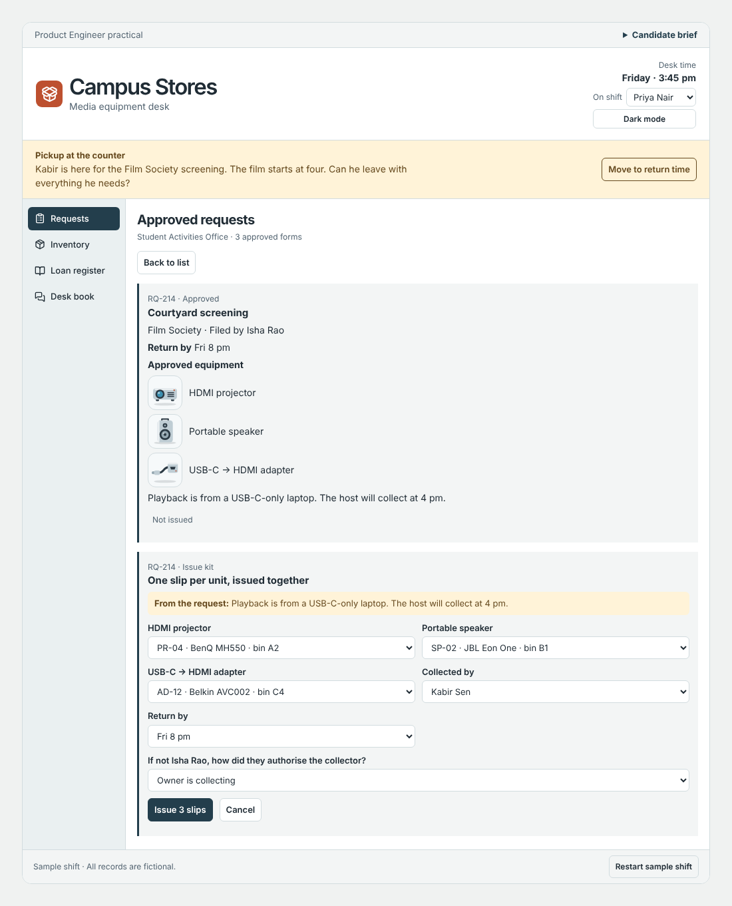
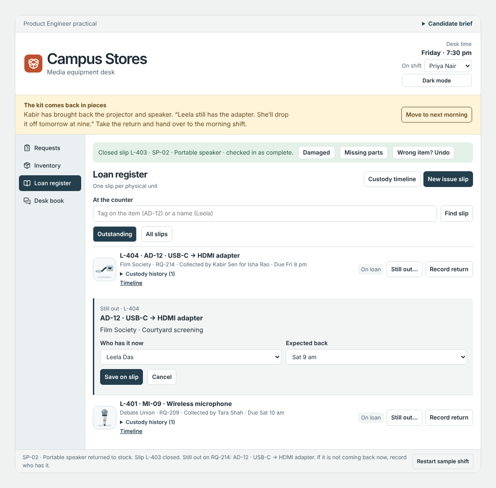
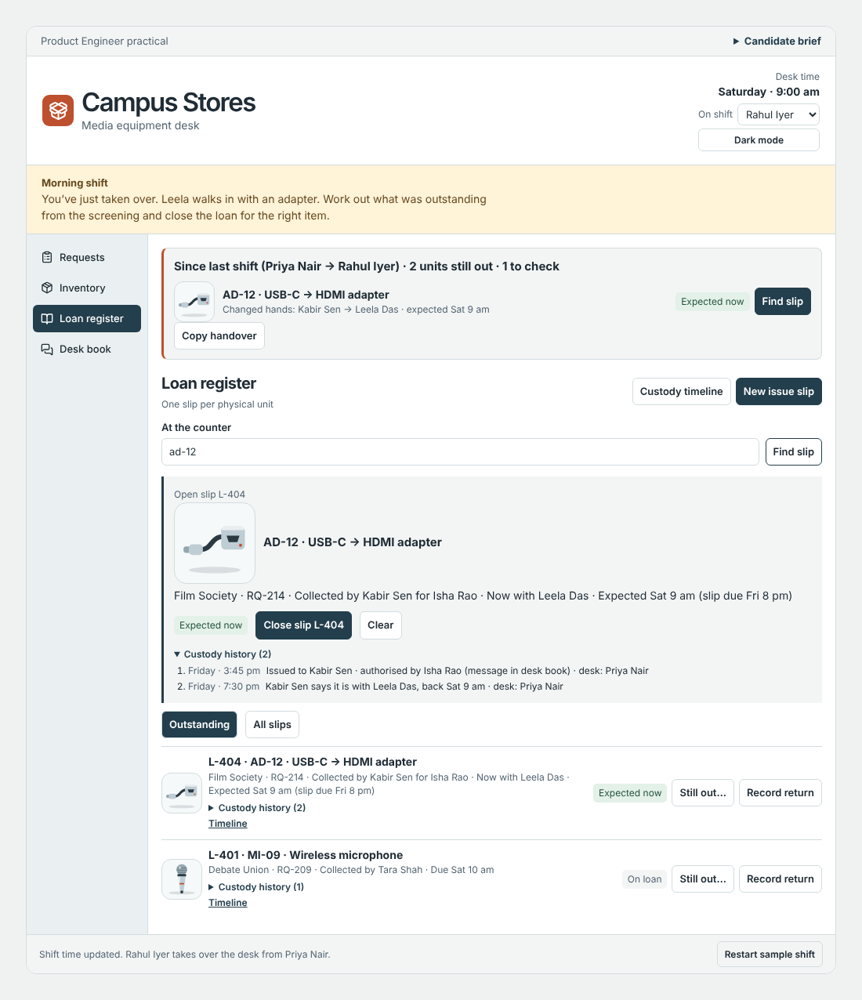
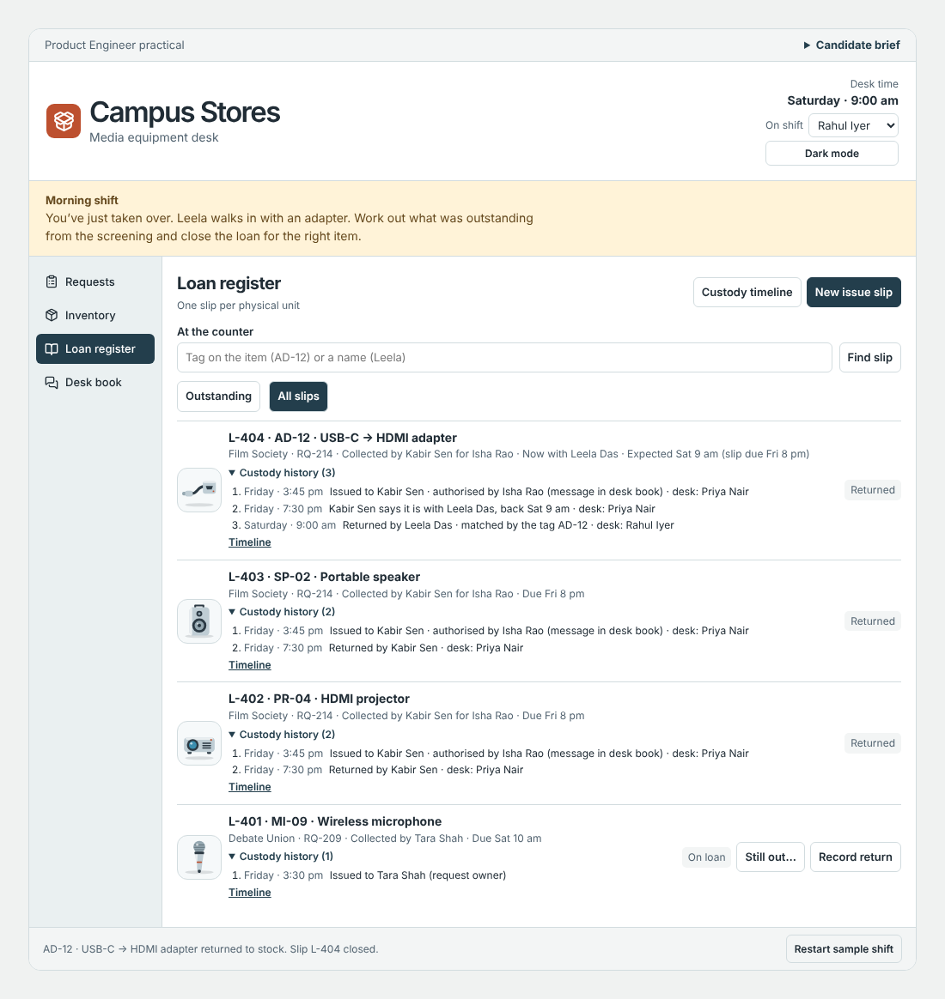
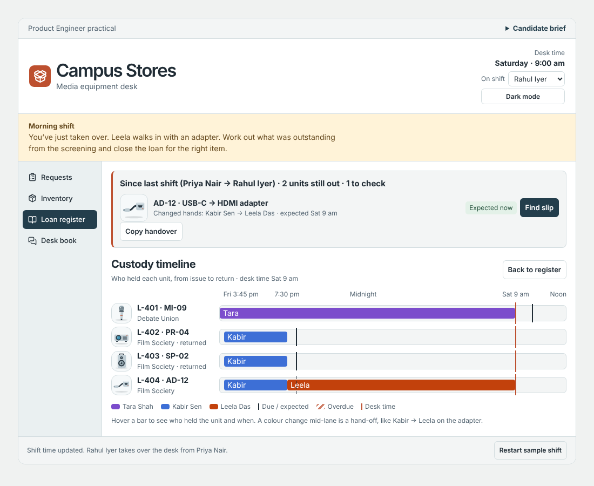

# Campus Stores

> **Reviewers, start here:** my write-up is in [Submission](#submission) below. The change touches Requests and the Loan register (`app.js`, `styles.css`). Open `index.html` and click **Restart sample shift** to play it from the start.

## Submission

**Would I keep this product?** Yes. One slip per physical unit is the right model. What it lacks is a record of **who has each unit right now, and on whose say-so**. Today that lives in people's heads and in free-text Desk book notes. My change makes the slip carry its own **chain of custody**, from pickup to close.

### A moment it handles well: the partial return (Fri 7:30 pm)

Kabir came back with the projector and speaker but not the adapter. Because every unit has its own slip, I closed two slips and the adapter slip stayed open on its own. Nothing to split, nothing to undo. Issuing is also safe: the projector in repair (PR-06) never appears as an option, and a second adapter on RQ-214 is blocked.

### A moment I would change: the Saturday handover (Sat 9:00 am)

Kabir said, *"Leela has the adapter. She'll drop it off at nine."* The register had nowhere to put that. The slip still read *Kabir Sen · Due Fri 8 pm*. As the morning shift, I had to:

- piece the story together from the Desk book and the register,
- map `AD-12` to "adapter" myself, because the register shows unit IDs only, and AD-12 and AD-15 are identical adapters in the same bin, C4,
- trust Leela, whose name appears on no record, and guess whether Isha, who filed the request, even knew.

Looking back, the same gap started at **pickup**. Kabir collected Isha's kit on the strength of a Desk book message, and the slip didn't record that. The custody problem runs through the whole shift, so the fix does too.

### The change: one chain of custody per slip

Each link answers the question a staff member actually has at that moment.

| Moment | Question at the counter | What the app now does |
|---|---|---|
| **Pickup** | "Can Kabir take Isha's kit?" | **Issue this kit** from the request: one form, one slip per unit, due time taken from the request. If the collector isn't the owner, you must record how the owner authorised them. |
| **Partial return** | "Where is the rest, and who has it?" | After a return, the status bar lists what's still out. **Still out…** records who has the unit now and when it's expected back. The slip and the Desk book are updated together. |
| **Morning** | "Which slip is this adapter?" | **At the counter:** type the ID on the tag (or the person's name) to get the one open slip, with its history, and close it. A wrong unit (e.g. AD-15) is caught: "not on loan, home shelf C4". |
| **Any time** | "What happened to this unit?" | Every slip has a **custody history**, and rows show the equipment type and **Overdue**, **Expected now** or **On loan**. Inventory and each request show **who has every unit right now**, and requests show "1 of 3 still out". |

### Walking the same job with the change

1. **Fri 3:45 pm, pickup.** Requests → RQ-214 → **Issue this kit**. The units are pre-selected (PR-04, SP-02, AD-12) and the due time is Fri 8 pm. I set *Collected by: Kabir Sen*. The app asks how Isha authorised him, and I pick *Message in desk book*. Three slips are issued in one step, which is what you want with the film starting at four.
   
2. **Fri 7:30 pm, return.** I close the projector and speaker slips. Only the adapter is left, so **Still out…** opens on it: *Leela Das · Sat 9 am*. The slip now reads *Collected by Kabir Sen for Isha Rao · Now with Leela Das · Expected Sat 9 am*, and the Desk book gets a matching note.
   
3. **Sat 9:00 am, morning.** The adapter shows **Expected now** with Leela's name. Leela hands it over. I type `AD-12` and see the full story, two history lines from the night before, and **Close slip L-404**. The history records *Returned by Leela Das · matched by the tag AD-12*.
   
   

4. **Custody timeline.** From the Loan register, **Custody timeline** opens a view of all slips, and each slip's **Timeline** link shows just that unit. Every slip is a lane on a Fri 3:45 pm → Sat noon axis, coloured by who held the unit. The adapter lane turns from Kabir to Leela at 7:30 pm. Due times, overdue stretches and the current desk time are marked. It answers the audit question "who had the adapter at 10 pm on Friday?" without reading a single note.
   

If the evening shift skips step 2, the morning shift sees the adapter flagged **Overdue** under Kabir's name. The gap is visible instead of silent.

### Small supporting additions

- **Staff on shift (accountability, not login):** the header shows who is on the desk, and every custody entry and Desk book note is signed by them ("desk: Priya Nair"). Saturday opens with "Rahul Iyer takes over from Priya Nair", and the summary shows the handover (Priya → Rahul). I deliberately did not add a login and API: the app must open from `index.html` offline for reviewers, and a login without a server would be security theatre. Real authentication belongs with the backend.
- **Condition at check-in:** every return is "complete" by default, with one click for **Damaged** or **Missing parts**. Either sends the unit to repair so it can't be issued again by mistake, and leaves a Desk book note to follow up with the request owner.
- **Copy handover:** the "since last shift" panel copies a plain-text summary of everything still out (and in repair) to paste into the desk's group chat.
- **Find by tag or by person:** the counter box takes a tag (`AD-12`) or a name (`Leela`). When Leela walks in, the desk can pull up what she holds before she puts it down, then match the tag before closing.
- **Undo a wrong close:** closing the wrong slip (say the Debate Union mic instead of the adapter) can be undone in one click. The custody history keeps the mistake and the reopening.
- **The request's note at pickup:** "Playback is from a USB-C-only laptop" appears in the kit form, so the item the screening depends on can't be forgotten at 3:45 pm.
- **Since last shift:** from the return onwards, every screen opens with what is still out and needs checking ("Changed hands: Kabir Sen → Leela Das · expected Sat 9 am"), with a **Find slip** button. The morning shift sees the handover before Leela reaches the counter.
- **Item pictures:** each unit shows a small drawing of the equipment (projector, speaker, adapter, mic, camera), and the check-in card shows it large, so staff can compare the item in hand with the slip before closing it.
- **Stock at a glance:** Inventory opens with free/total counts per type ("1 of 2 HDMI projectors free · 1 in repair"), so at pickup you know at once whether a kit can go out.
- **Receive new stock:** **Add unit** gives a new unit its next tag ID (e.g. PR-07) and home shelf, so it can be issued, tracked and checked in like any other unit.

### At a real desk's scale

The sample has 8 units, so you can scan the register by eye. With 300, typing the tag ID is the only fast way to the right slip, partial returns and hand-offs become routine, and the "since last shift" list replaces asking around. The natural next step is scanning the tag instead of typing it.

### Why this matters beyond a campus desk

Shared hospital equipment (infusion pumps, wheelchairs, portable monitors) has the same problem: units move between wards and staff, and the record still names whoever first took them. Nurse shift handovers lose information in the same way the Saturday morning shift does here. A chain of custody on each unit, a summary at the start of each shift, and confirming the physical tag before closing a record carry over directly.

### What I kept

One slip per unit, every existing issue rule, the single **New issue slip** form for one-off loans, and the Desk book for conversation. No new screens. Each link adds fields and history to the slip; none of them changes what a slip is.

### What I considered and rejected

- **Barcode scanning at check-in.** It's the right end state, but it needs hardware. Typing the tag ID tests the same behaviour today.
- **Merging the Desk book into slips.** The Desk book holds conversation that isn't about any one unit. I mirror slip changes into it instead of replacing it.
- **Blocking a hand-off unless the owner confirms first.** That's too strict at 7:30 pm with Kabir standing at the counter. Recording the hand-off and surfacing it the next morning keeps the desk moving.

### The risk in my own change

It only works if the evening shift fills in **Still out…**. I reduced that risk in two ways: the form opens automatically when a request comes back short, and an unfilled slip goes **Overdue** the next morning. It can't be forced, so this is the first thing I'd watch.

### What I'd watch at a real counter

On mornings with a carried-over loan, I'd watch **whether the person closing it opens the Desk book or messages the previous shift before closing**. If the change works, they go straight from the tag to *Close slip* without asking anyone. Pass bar: across the first 10 carried-over loans, at least 8 are closed that way, with no slip closed against the wrong unit at the next stock count.

---

## About the app

Campus Stores is a Product Engineer work sample set at a fictional campus media equipment desk. Work through a club’s screening, from equipment pickup to a partial return and the next morning’s handover. Open **Candidate brief** in the app for the assignment.

## Run the app

Open `index.html` in a modern browser. The app includes its scripts, styles, and icons and can run offline.

To serve it over local HTTP, run this from the repository folder and visit `http://localhost:8000`.

```sh
python3 -m http.server 8000 --bind 127.0.0.1
```

Each browser stores its own sample shift locally when browser storage is available. **Restart sample shift** restores the fictional starting records.

## Source

- `index.html` contains the desk layout, candidate brief, and bundled icons.
- `app.js` contains the sample records and interactions.
- `styles.css` defines the desktop and mobile layouts.

Icon license notices are in [third-party/lucide-LICENSE.txt](third-party/lucide-LICENSE.txt).


## Submit your work

1. [Fork Campus Stores](https://github.com/virinchi-healthcare/campus-stores/fork) into your GitHub account. Complete the candidate brief and push your changes to your public fork. In your README, point reviewers to your work and explain the decision you made.
2. In your fork, open **Commits**, select the final commit you want reviewed, and copy the page URL. It should look like `https://github.com/YOUR-USERNAME/campus-stores/commit/COMMIT-SHA`.
3. [Submit your work through the Google Form](https://docs.google.com/forms/d/e/1FAIpQLScvzoh1R4WS-SkiwAVBQbMvniieJYSoOEfLMyVo5CyjOvYUgQ/viewform). Your **roll number**, **email ID**, and **final commit link from your public fork** are required. Enter your roll number and email ID in the form only.
